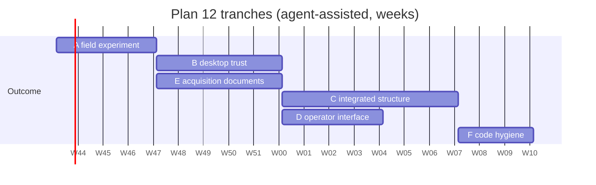

# Plan 12: Review closure

## Purpose

Resolve the ten consolidated actions in section 11 of the comprehensive review of
2026-10-26 (`../review/2026-10-26-comprehensive-review.md`). The review graded the system
C+ overall: a disciplined, honest single node whose engineering quality runs ahead of its
operational maturity, with every High finding of one shape, the system works with itself
and stops at its own edge. This plan turns those findings into work the register tracks:
one gap per work package, one decision per question only the owner can answer, and six
tranches ordered so each is a shippable outcome and the earliest is the smallest.

The plan is a work order. It does not change a pass criterion, does not restate a status
the generated sources own, and does not decide anything; it files what has to be decided.

## Scope

**In scope.** All ten actions of the review's section 11, as the owner chose on
2026-10-26, covering engineering, the operator interface and the acquisition documents.
Thirty-eight gaps filed (GAP-203 to GAP-240) and nine decisions raised (D-136 to D-144),
all in `../mission/gap-analysis/data/`. Action 1 of the ten, the stale-prose sweep,
landed on `main` as pull request #227 before this plan was written and is recorded here
as done.

**Out of scope.** Implementation under this plan. No crate gains code by this change;
every gap below is engineering the register sequences. Also out of scope: the business
documents, excluded from the repository by the owner's decision; the assistant (GAP-044,
plan 08); trained models (GAP-079, GAP-080, plan 09); and the random-finite-set
remainder (GAP-015), none of which the review found blocking any of its outcomes.

## Inputs

- `../review/2026-10-26-comprehensive-review.md`: the review, at `9e9fe9f5`.
- `../mission/gap-analysis/data/gaps.yaml` and `decisions.yaml`: ids GAP-203 to GAP-240
  and D-136 to D-144 were taken against `origin/main` at `93afd78d`. If another change
  files ids first, this plan's entries are renumbered before merge, never the other's.
- The design notes each gap cites (DN-05, DN-07, DN-09, DN-10, DN-16, DN-17, DN-18,
  DN-22, DN-23, DN-25, DN-31, DN-32) and the record items under `../record/` they point at.
- `../verification-capability-table.md` §2 for the rows a closure owes.
- `../agentic-workflow.md` for which crates are human-owned, which decides who reviews
  each tranche.

## Deliverables and target location

| Deliverable | Where |
|---|---|
| This plan | `docs/plans/12-review-closure.md` |
| The review it closes | `docs/review/2026-10-26-comprehensive-review.md` (committed with this plan so its citations resolve) |
| Thirty-eight gaps, one per work package | `docs/mission/gap-analysis/data/gaps.yaml`, rendered into the five generated documents |
| Nine open decisions with a recommended default each | `docs/mission/gap-analysis/data/decisions.yaml`, rendered into `decisions-needed.md` |
| One new design note (airspace control measures, DN-34) | `docs/design/`, written under GAP-217 when that tranche starts |
| A cloud and multi-node design note | `docs/design/`, written under GAP-220 after D-138 |
| A hazard analysis | `docs/safety/`, written under GAP-229 |
| A system security plan skeleton and a STIG posture note | `docs/architecture/togaf/` or `docs/safety/`, written under GAP-230 |
| A role-keyed operator guide | `docs/guide/`, written under GAP-231 |
| A rights, export and license-status page | `docs/`, written under GAP-232 |
| A release evidence step (dated test report, version description, regenerated overview) | `.github/workflows/release.yml` and `docs/release-governance.md`, under GAP-233 |

## Deliverable outline: the six tranches

The review's section 11 ordered ten actions. The tranches below group them by the
outcome each produces, in the order the owner chose: the fixed-site field experiment
first. Within a tranche, the gaps are in dependency order.

### Tranche A: the fixed-site counter-UAS field experiment

What it produces: a desktop a single operator can stand up, provision, discipline to the
site's clock, run the decision loop on during a raid, hand an engagement to one real
effector from, and learn the outcome on. The review's section 6 names this as the
minimum closure set.

| Gap | Work package | Owner | Effort |
|---|---|---|---|
| Done (#227) | Action 1: the stale status prose now cites its generated source | | |
| GAP-203 | Weapons control status changed live, audited, no restart; desktop and node | Security engineer (human-owned) | M |
| GAP-204 | The desktop provisions its own accounts | Security engineer (human-owned) | S |
| GAP-205 | Clock discipline from a named sensor; wider late-data default for undisciplined hosts | Services engineer | M |
| GAP-206 | Tracks releasable from configuration, per DN-17 §5 and §6 | Security engineer (human-owned) | M |
| GAP-207 | One effector adapter and an outcome path on the embedded profile | Services engineer | L |
| GAP-001 | The trial's radar adapter if it is not SAPIENT or ASTERIX (existing gap, in progress) | Services engineer | per the trial |

Decisions: D-144 (what the experiment is), D-140 (single approval recorded as a decision;
GAP-203 does not wait on it).

GAP-206 sits here rather than in tranche C because the two-node picture is the first
thing a trial partner with a second desktop or a peer node will ask to see, and because
it is a prerequisite for every exchange item in tranche C.

### Tranche B: the disconnected desktop stops trusting itself

What it produces: a desktop whose audit record, decisions, baseline and identities an
accreditor can take at face value when it reconnects.

| Gap | Work package | Owner | Effort |
|---|---|---|---|
| GAP-208 | Audit anchors signed under a purpose the operator cannot unlock; forwarded to the node | Security engineer (human-owned) | M |
| GAP-209 | The node re-derives the role of forwarded decisions; arbitration takes that rank | Security engineer (human-owned) | M |
| GAP-210 | Baselines signed under `BaselineSigning`; unsigned refused in connected profiles | Security engineer (human-owned) | M |
| GAP-211 | Validity and revocation on issued identities | Security engineer (human-owned) | M |
| GAP-212 | Token key in the key provider; role re-read; revocation; lifetime and idle timeout; monotonic expiry | Security engineer (human-owned) | M |
| GAP-213 | Fuzz targets for the five unfuzzed parsers; `AllowAll` refused on a node | Services engineer | M |
| GAP-214 | Transport deadlines, limits, TLS 1.3 only | Services engineer | S |
| GAP-215 | Sealed-file permissions on both hosts; secrets zeroized; per-user data directory | Security engineer (human-owned) | S |

Decisions: D-142 (which key signs anchors), D-143 (lifetime and idle timeout).

Every gap but two in this tranche is in a human-owned crate. The owner's review is the
critical path, not the engineering, so the eight are sized to land as eight small pull
requests rather than one.

### Tranche C: a seat in an integrated command structure

What it produces: a node that can publish its picture in a standard a higher headquarters
consumes, consume the airspace control that headquarters hands down, keep one identity
for a track across nodes, and show a neighbour's engagement. The order is forced: the
identity vocabulary before the bearer, the bearer before the measures.

| Gap | Work package | Owner | Effort |
|---|---|---|---|
| GAP-216 | `Classification` widened to STANAG 1241 | Services engineer | M |
| GAP-090, GAP-091 | The Cursor-on-Target bearer, DN-25 (existing gaps, open) | Security engineer (human-owned), Services engineer | M, L |
| GAP-217 | Polygon airspace control measures with altitude bands; both chains fed; status by zone (DN-34) | Security engineer (human-owned) | L |
| GAP-218 | Global identity and originating node on the wire; re-ingest guard; covariance intersection for peer tracks | Services engineer | L |
| GAP-219 | Engagement opened and closed published over the exchange | Services engineer | M |
| GAP-220 | The cloud and multi-node design note and manifests | Services engineer | L |
| GAP-221 | The fan-out, snapshot-latency and recovery harness | Services engineer | M |
| GAP-222 | Metrics export | Services engineer | S |

Decisions: D-136 (identity vocabulary), D-137 (tactical data links beyond
Cursor-on-Target), D-138 (cloud scaling model), D-141 (cross-node engagement visibility).

### Tranche D: the operator interface

What it produces: a console an operator can run from the keyboard, hook a track on,
acknowledge an alert on, and that has been sat in front of by someone who did not write
it.

| Gap | Work package | Owner | Effort |
|---|---|---|---|
| GAP-223 | The alert lifecycle wired; PN-08 with acknowledge, escalate, close | UI engineer | M |
| GAP-224 | The five shortcuts and the tab order, with render-probe tests | UI engineer | M |
| GAP-225 | Map hit-testing, the selection halo, an asset and effector layer | UI engineer | M |
| GAP-226 | Three-d scene off until seen; PN-03 virtualised with sort and filter | UI engineer | S |
| GAP-228 | Operator-initiated escalation | Security engineer (human-owned) | S |
| GAP-227 | Geographic readout, standard symbology, declutter, basemap tiles | UI engineer | L |
| GAP-074 | Usability round 1 with non-author participants; provisional MOP-37 targets (existing gap, in progress) | Plan 06 lead | M |

Decision: D-139 (symbology standard). GAP-074 is run after GAP-223 to GAP-226 land, so the
first participants see the console the review describes rather than the one it found.

### Tranche E: the acquisition documents

What it produces: the deliverables a program office asks for at a milestone and found
absent: a hazard analysis, an accreditation package skeleton, an operator guide, a rights
statement, and dated release evidence.

| Gap | Work package | Owner | Effort |
|---|---|---|---|
| GAP-229 | Hazard analysis for the engagement authority path | Owner | L |
| GAP-230 | System security plan skeleton with an 800-53 mapping; STIG posture note | Owner | L |
| GAP-231 | Role-keyed operator guide; desktop installation and provisioning | Services engineer | M |
| GAP-232 | Rights, export-control and license-status page | Owner | S |
| GAP-233 | Dated test report, version description, regenerated overview in the release package | Services engineer | M |

No decision. Three of the five are the owner's to write, because they state positions
(hazard acceptance, control coverage, rights) that an agent may draft and may not take.
They can run beside tranches B to D; nothing in them waits on code, and GAP-229 and
GAP-230 are stronger if they are written while tranche B is being built, since each
mechanism that tranche adds is a control the plan cites.

### Tranche F: code hygiene

What it produces: the review's A- grade for Rust practice made a guarantee rather than
an observation.

| Gap | Work package | Owner | Effort |
|---|---|---|---|
| GAP-238 | `unsafe_code = "forbid"`, `missing_docs`, `unwrap_used` and `expect_used` in the workspace lints | Services engineer | S |
| GAP-234 | One lock-poisoning policy applied to the silent sites | Services engineer | M |
| GAP-237 | In-crate unit tests for `gungnir-approval` | Security engineer (human-owned) | S |
| GAP-236 | `thiserror` on the remote identity surface, then the desktop | Security engineer (human-owned) | M |
| GAP-239 | The rehearsal off the frame thread; a depth bound on the bus | UI engineer | S |
| GAP-235 | The three largest files split | Services engineer | M |
| GAP-240 | Dependency-linkage notes and dead advisory ignores refreshed | Services engineer | S |

No decision. GAP-238 goes first because it turns the rest of the tranche into compiler
errors rather than review comments, and GAP-235 last because splitting files while other
tranches edit them is the one way this tranche can cost more than it saves.

## Method

1. **Verify before filing.** Every gap's evidence column was checked against the code at
   `9e9fe9f5` during the review and re-checked for the lines it cites before this plan
   was written. A gap whose evidence no longer holds at the time its tranche starts is
   closed with a history entry saying so, not built.
2. **One pull request per gap, targeting `main` directly.** Never stacked: a stacked
   chain in this repository has shown every pull request as merged while none of the work
   reached `main`. Each pull request appends the gap's history entry, and a record item
   under `../record/` where the why needs more than 120 words.
3. **Human-owned crates get the owner's review per `../agentic-workflow.md`.** Nineteen
   of the thirty-eight gaps touch `gungnir-security`, `gungnir-policy`,
   `gungnir-command`, `gungnir-approval` or `gungnir-remote`'s identity path. They are
   sized small on purpose, so that each review is one sitting.
4. **Decisions are walked, not assumed.** The nine decisions carry a recommended default
   in their outcome field. A gap that depends on a decision does not start until the
   decision is taken; a gap whose decision is only cited (GAP-203 and D-140) starts at
   once. The owner has walked decisions four at a time with a recommended default each;
   this plan is written for that cadence.
5. **A verification row before a closure.** Every gap that changes behaviour names the
   `../verification-capability-table.md` §2 row it owes in its first pull request. Rows
   that need a new criterion are the owner's.
6. **Generated sources only.** The register is regenerated by
   `docs/mission/gap-analysis/tools/gen_gaps.py` after every edit to the data; status
   lives in a gap's last history entry and nowhere in prose, this plan included.
7. **The review is not updated.** It records the state at `9e9fe9f5` and says so. A
   later review is a new file under `docs/review/`.

## Roles

| Role | Owns in this plan |
|---|---|
| Owner | Every decision D-136 to D-144; every human-owned review; GAP-229, GAP-230 and GAP-232 as author; the usability session's participants |
| Security engineer (human-owned crate) | GAP-203, 204, 206, 208 to 212, 215, 217, 228, 236, 237 and GAP-090 |
| Services engineer | GAP-205, 207, 213, 214, 216, 218 to 222, 231, 233 to 235, 238, 240 and GAP-091 |
| UI engineer | GAP-223 to 227, 239 |
| Plan 06 lead | GAP-074 |
| Mission subject-matter expert | The hazard list in GAP-229 and the measure kinds in GAP-217, reviewed against the threads |

## Dependencies

- Tranche A depends on nothing outside itself; GAP-207 waits on D-144 for the effector's
  name and builds against the SAPIENT task path until then.
- Tranche B's GAP-208 waits on D-142 and GAP-212 on D-143. The rest start at once.
- Tranche C is a chain: D-136 before GAP-216, GAP-216 before the Cursor-on-Target bearer,
  GAP-206 (tranche A) before GAP-218, GAP-218 and D-141 before GAP-219, D-138 before
  GAP-220. GAP-217 and GAP-221 are independent of the chain.
- Tranche D's GAP-227 waits on D-139; GAP-074 waits on GAP-223 to GAP-226.
- Tranche E's GAP-231 waits on GAP-204 so the guide documents a provisioning path that
  exists. The rest start at once.
- Tranche F's GAP-235 waits until tranches A and B have landed in the files it splits.

The register's closure roadmap renders these from the `deps` fields and orders by
priority within an increment; the tranche order above is what this plan asks for and
the roadmap does not know. Where the two disagree, the tranche order wins, because the
field experiment is the outcome the owner chose first.

## Effort and sequencing

Agent-assisted person-days, one person directing agents, with the human-owned reviews
noted; drafts, not commitments, and the reviews are where elapsed time goes.

| Tranche | Days | Human-owned share |
|---|---|---|
| A: field experiment | 15 to 25 | Three of five gaps; D-144 |
| B: desktop trust | 20 to 30 | Six of eight gaps; D-142, D-143 |
| C: integrated structure | 30 to 45 | Two gaps and the bearer's security half; D-136 to D-138, D-141 |
| D: operator interface | 15 to 25 | One gap; D-139; the usability participants |
| E: acquisition documents | 15 to 25 | Three of five as author |
| F: code hygiene | 10 to 15 | Two gaps |
| Total | 105 to 165 | |

Sequencing: A alone first, since it is the outcome the owner chose and every later
tranche is easier to demonstrate on a desktop that can be stood up in the field. B and E
together next, because E cites what B builds. C after B, because the exchange rests on
the trust B establishes. D in parallel with C, since the two share no files. F last, with
GAP-238 pulled forward to the start of B so the lints catch the rest.

## Acceptance criteria

1. Every one of the ten actions in the review's section 11 maps to a closed gap, a taken
   decision, or a recorded reason it was not done.
2. Tranche A: a desktop started from a release artifact on a Windows laptop with no node
   provisions an account, disciplines its clock to a named sensor, changes weapons control
   status under audit without a restart, hands one engagement to one real effector, and
   shows the effector's report; and one tracker-produced track crosses a peer link in a
   two-node test while an `Internal` one does not.
3. Tranche B: a rewritten desktop audit file is detected on reconnect; a forwarded
   decision with a forged role is refused; an unsigned baseline is refused on a node; an
   issued identity expires and a revoked one is refused; a demoted operator loses
   authority on the next request; the five parsers have fuzz targets that have run a
   night.
4. Tranche C: a Cursor-on-Target client receives a track with the right type letter; an
   airspace measure with an altitude band denies a plan in both chains; a track keeps one
   identity across two nodes and a loop is refused; a neighbour's engagement is on the
   track; the fan-out harness measures the budgets the document names.
5. Tranche D: every accessibility shortcut works and Enter never accepts; a track can be
   hooked on the map; an alert can be acknowledged, escalated and closed; one usability
   session with at least two non-author participants has a filled report and provisional
   MOP-37 targets.
6. Tranche E: each document exists, cites the mechanism or design note that holds each
   claim, and states what it does not cover.
7. Tranche F: the three lints are on and the workspace builds; the silent lock sites are
   gone; `gungnir-approval` has in-crate tests on every state transition.
8. The register, the decision ledger, the roadmap and the coverage matrix regenerate
   byte for byte, and `docs/plans/README.md` and `docs/README.md` carry this plan's row.

Criteria 2 to 4 are checked by a human against a running system, not by the drafting
agent, on every gap that touches policy, command, approval, security or the ingest
gateway.

## Risks

| Risk | Mitigation |
|---|---|
| The field experiment has no partner, so tranche A's adapter has no target | D-144 names the default (SAPIENT task path); the adapter is built against it and swapped when a partner names an interface |
| Nineteen human-owned reviews serialize on one person | Small pull requests, one sitting each; tranche E runs beside them and needs no code review |
| Widening `Classification` breaks the wire | The schema version rule (plan 11, option B) already covers it: a new version, the old one answers with its successor |
| Releasability from configuration releases something it should not | The default stays `Internal`; only a baseline field widens it; the two-node test proves one `Internal` track does not cross |
| The acquisition documents restate status and go stale | Each cites the gap id or generated source, as the stale-prose sweep now does everywhere else |
| Gap ids collide with a parallel batch | Ids taken at `93afd78d`; the generator refuses duplicates; this plan renumbers, not the other |
| Tranche F's file splits conflict with every other tranche | Scheduled last |

## Open questions

- **Which effector and which radar.** D-144's default is the SAPIENT task path; the
  trial partner's interface replaces it when known.
- **Whether `docs/safety/` is the right home** for the hazard analysis and the security
  plan, or whether they belong under the TOGAF set as compliance artifacts. The plan
  proposes a new folder because neither is an architecture document.
- **Whether the operator guide is generated or written.** The panel catalogue and the
  task analyses already name every panel and field; a generator would keep the guide
  current the way `unbuilt.md` is. The plan proposes generating the reference half and
  writing the narrative half.
- **The mobile unit.** The review's small-unit section rated a mobile or dismounted unit
  as not viable and this plan files no gap for it: a moving frame origin and own-position
  are a design question (a DN) before they are a gap, and no tranche above needs them.
- **Second review.** Once tranches A and B have landed, a second review under
  `docs/review/` re-grades the areas they touched; it is not a deliverable of this plan.
